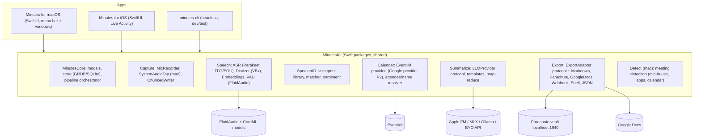
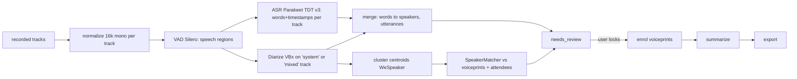

# Minutes: Technical Architecture

> Companion to [PRD.md](PRD.md). Facts and sources are in [research/findings.md](research/findings.md).

## 1. Overview



**Main decisions** (see [DECISIONS.md](DECISIONS.md)):
1. **Native Swift 6 + SwiftUI multiplatform, not a Meetily fork.** It's the only way to get first-class macOS system-audio taps, iOS background audio and Live Activities, plus FluidAudio's Swift API.
2. **A shared `MinutesKit` package** holds all logic. The apps are thin UI shells. **`minutes-cli`** runs the whole pipeline on a file so agents can test everything headlessly (and it's useful for batch imports).
3. **The batch pipeline is the source of truth**: the final transcript always comes from offline ASR + offline VBx diarization after the meeting. The live transcript is a disposable preview.
4. **Two-channel capture on Mac** (mic = Me, system = Them). Diarize only the "them" channel, which makes diarization easier and "Me" attribution nearly perfect.
5. **GRDB (SQLite)** for storage, not SwiftData: explicit migrations, FTS5 search, testable from the CLI, blobs for embeddings.
6. **EventKit first** for calendar (no OAuth). The Google Calendar API is an optional later provider.
7. **Adapters behind a protocol.** Parachute is the first-class adapter.

## 2. Repository layout
```
minutes/
  README.md AGENTS.md STATUS.md
  docs/ PRD.md ARCHITECTURE.md IMPLEMENTATION_PLAN.md DECISIONS.md research/
  MinutesKit/                      # Swift package (swift-tools 6.0), platforms: macOS 15, iOS 18
    Package.swift
    Sources/
      MinutesCore/                 # Models, Store (GRDB), Pipeline, Settings, Logging
      MinutesCapture/              # MicRecorder, SystemAudioTap(macOS), ChunkedAudioWriter, Mixer
      MinutesSpeech/               # ASRService, DiarizationService, EmbeddingService, VADService, Merger
      MinutesSpeakerID/            # VoiceprintStore, SpeakerMatcher, Enrolment
      MinutesCalendar/             # CalendarProvider, EventKitProvider, NameResolver, ConferenceLinkParser
      MinutesSummarize/            # LLMProvider, AppleFMProvider, MLXProvider, OpenAICompatProvider, Templates, MapReduce
      MinutesExport/               # ExportAdapter, MarkdownAdapter, ParachuteAdapter, GoogleDocsAdapter, WebhookAdapter, ShellAdapter, JSONAdapter
      MinutesDetect/               # MeetingDetector (macOS only)
      minutes-cli/                 # executable target (ArgumentParser)
    Tests/ (one test target per module) + Fixtures/ (audio clips, calendar JSON, golden transcripts)
  Apps/
    Minutes.xcodeproj  (generated by XcodeGen from project.yml — keep project.yml as source of truth)
    project.yml
    MinutesMac/                    # SwiftUI app: MenuBarExtra, RecorderPanel, LibraryWindow, ReviewView, Settings
    MinutesiOS/                    # SwiftUI app + MinutesLiveActivity widget extension
    Shared/                        # Shared SwiftUI views (ReviewSpeakersView, TranscriptView, SummaryEditor, PeopleView)
```

## 3. Data model (GRDB / SQLite, `MinutesCore/Store`)
```sql
CREATE TABLE person (
  id TEXT PRIMARY KEY, display_name TEXT NOT NULL, is_me INTEGER DEFAULT 0,
  name_source TEXT,               -- calendar|contacts|heuristic|user
  parachute_note_id TEXT, created_at, updated_at);
CREATE TABLE person_email (person_id TEXT REFERENCES person ON DELETE CASCADE, email TEXT UNIQUE COLLATE NOCASE);
CREATE TABLE voiceprint (
  id TEXT PRIMARY KEY, person_id TEXT REFERENCES person ON DELETE CASCADE,
  model TEXT NOT NULL,            -- e.g. 'wespeaker_v2' (embeddings are model-specific!)
  dim INTEGER NOT NULL, vector BLOB NOT NULL,   -- Float32 L2-normalized
  source_meeting_id TEXT, speech_seconds REAL, quality REAL, channel TEXT, created_at);
CREATE TABLE meeting (
  id TEXT PRIMARY KEY, title TEXT, started_at, ended_at, platform TEXT,   -- zoom|meet|teams|inperson|import
  calendar_event_id TEXT, calendar_external_id TEXT, conference_url TEXT,
  status TEXT,                    -- recording|recorded|transcribing|diarizing|needs_review|summarizing|finalized|failed
  device TEXT, user_notes TEXT, template_id TEXT, retention_until);
CREATE TABLE meeting_attendee (meeting_id, person_id, email, response_status, is_organizer, PRIMARY KEY(meeting_id, email));
CREATE TABLE track (id TEXT PRIMARY KEY, meeting_id, role TEXT /*mic|system|mixed|import*/, path TEXT, sample_rate, duration);
CREATE TABLE speaker_cluster (
  id TEXT PRIMARY KEY, meeting_id, track_id, label TEXT,           -- 'A','B'…
  centroid BLOB, speech_seconds REAL,
  person_id TEXT NULL, assignment TEXT /*auto|suggested|user|me_channel*/, confidence REAL);
CREATE TABLE utterance (id INTEGER PRIMARY KEY, meeting_id, cluster_id, start REAL, end REAL, text TEXT, words_json TEXT);
CREATE VIRTUAL TABLE utterance_fts USING fts5(text, content='utterance', content_rowid='id');
CREATE TABLE summary (meeting_id PRIMARY KEY, template_id, provider, markdown TEXT, json TEXT, created_at, edited INTEGER);
CREATE TABLE bookmark (meeting_id, t REAL, note TEXT);
CREATE TABLE export_run (id, meeting_id, adapter_id, status, external_ref TEXT, error TEXT, at);
CREATE TABLE pipeline_step (meeting_id, step, status, started_at, finished_at, error, PRIMARY KEY(meeting_id, step));
```
Files live under `Application Support/Minutes/meetings/<id>/{mic.caf, system.caf, chunks/, artifacts/(asr.json, diar.json, merged.json)}`.

## 4. Capture (`MinutesCapture`)
### macOS
- **MicRecorder**: `AVAudioEngine.inputNode` tap at the device rate, converted to 48 kHz mono Float32 and written by `ChunkedAudioWriter` (CAF, a new segment file every 5 min, flush every 5 s, segments listed in `chunks/index.json`).
- **SystemAudioTap**: Core Audio **process tap** (macOS 14.2+ API; we require 15). `CATapDescription(stereoGlobalTapButExcludeProcesses: [ownPID])` (or per-app taps for the detected meeting app). Create a private aggregate device containing the tap, run an IOProc, then convert to 48 kHz mono and write. Permission: `NSAudioCaptureUsageDescription`. Reference implementation: insidegui/AudioCap.
- Both writers share a **host-time anchor** (`mach_absolute_time` at the first buffer of each), so the tracks align to the millisecond. Stored in `track` metadata.
- **Echo/bleed:** if the user isn't on headphones, remote voices bleed into the mic. Mitigation: (a) at merge time, mic segments whose embedding matches a "them" cluster better than "Me" get reassigned; (b) optionally run FluidAudio **LocalVQE** AEC on the mic track with system audio as the far-end reference (beta; spike MN-0.4).

### Current microphone implementation and acceptance (2026-10-15)

`MinutesSpeech.AudioCaptureService` writes PCM16 mono 16 kHz WAV audio and exposes committed-frame duration plus measured RMS levels. The microphone display polls at 20 Hz. Build 29 isolates those samples in `RecordingMeterModel`; only a small Canvas/readout subscribes, while app-wide duration publishes at first audio, whole-second boundaries and Stop. History advances with committed audio even when volume stays constant, and freezes if committed duration stalls. Finalized audio supplies the exact Stop duration. Build 28 requests 1024-frame input batches; actual hardware scheduling and perceived responsiveness require physical verification.

Physical iPhone build 27 still fails intermittently before its first frame. Diagnostics identify `kAudioUnitErr_FormatNotSupported` (-10868) when restarting the retained engine after a configuration halt. Matching cached bus formats and reactivating the session did not resolve it. Build 28 implements a fresh iOS graph/native-format tap boundary with atomic callback generations and independent lifecycle review; the suite and physical-device build pass, and the owner confirmed the first phone recording succeeds with 14.299 seconds committed and no capture error. Broader recording reliability remains an open hardware acceptance gate. The original startup watchdog, sticky errors, and preservation of already committed audio remain required. The iOS capabilities listed below are architectural targets where not separately verified in STATUS.md; interruption handling currently stops visibly instead of claiming seamless resumption.

### iOS
- `AVAudioSession` category `.playAndRecord`/`.record`, mode `.measurement` (less processing) or `.default`. `UIBackgroundModes: audio`. Same ChunkedAudioWriter; a single `mixed` track.
- **iOS 18 `AudioRecordingIntent`:** An `AppIntent` adopting `AudioRecordingIntent` enables starting the recording directly from a Lock Screen control, Control Center, or Live Activity button without foregrounding the main application. It writes audio chunks to a shared App Group container (`group.app.minutes`).
- If launched from a local notification or the app itself, recording starts directly in foreground then persists in the background. A Live Activity (ActivityKit) shows the elapsed timer, active level meter, and a Stop button (App Intent).
- Handle interruptions (`AVAudioSession.interruptionNotification`: incoming phone calls) by flushing and closing the active segment, then resuming seamlessly after deactivation.

## 5. Speech pipeline (`MinutesSpeech` + `MinutesCore/Pipeline`)

- **Orchestrator:** `Pipeline` actor runs the steps and persists `pipeline_step` rows. Each step is idempotent and reads/writes artifacts in `artifacts/`. Resume from the first incomplete step. Runs as a background task (macOS: low QoS; iOS: `BGProcessingTask` if the app gets backgrounded mid-processing, otherwise foreground with a progress UI).
- **ASR:** FluidAudio `AsrManager` configured with **Parakeet Ultra** (`AsrModelVersion.ultra`, INT8 595 MB on ANE, 2.13% LibriSpeech clean) by default, or `v3` (`AsrModelVersion.v3`, 2.27%) / `v2` (English only). Long-form audio uses FluidAudio's internal `SlidingWindowAsrManager` with fixed 240,000-sample (15.0 s) windows, 2.0 s overlap, mel context prepending, and word/token timestamps (`ASRResult.tokenTimings`).
- **Diarization:** `OfflineDiarizerManager` on the "them" track (Mac) or the mixed track (iOS/import). Output: `TimedSpeakerSegment` array (`speakerId`, `startTimeSeconds`, `endTimeSeconds`, `embedding: [Float]`, `qualityScore`).
  - **Speaker Count Hints:** `OfflineDiarizerConfig.Clustering` directly supports `minSpeakers`, `maxSpeakers`, and `numSpeakers` with `constrainedAssignment: true`. When a calendar event provides an attendee count $N$, set `minSpeakers = max(2, N - 1)` and `maxSpeakers = N + 2` to guide K-Means reclustering without hardcoding an incorrect count.
  - **Compute Optimization:** `skipStrategy: .maskSimilarity` skips redundant embedding extractions on ANE (~6.5 ms per call).
- **Mic channel = Me:** on Mac, VAD regions in the mic track become `cluster(label: "Me", assignment: me_channel, person: me)`. If the mic is shared by several people in a room (a hybrid meeting), the user can toggle "Others were in the room with me", which then diarizes the mic track too.
- **Cluster embeddings:** for each cluster, extract WeSpeaker v2 256-dim embeddings over its longest clean segments (≥ 1.5 s, no overlap, ranked by duration). Average and L2-normalize into the centroid. Keep the top 3 segments as **audio samples** for the review UI.
- **Merge:** assign each ASR token/word to the diarization segment with maximum time overlap (ties go to the previous speaker). Then group consecutive words of the same speaker into utterances (split on > 1.5 s pauses or sentence ends).

## 6. Speaker identification (`MinutesSpeakerID`)
**Voiceprint store:** multiple embeddings per person (up to 10 kept: diverse meetings, highest quality), tied to the embedding `model` id. If the model changes, re-enrol from stored samples (we keep short sample clips per voiceprint for exactly this reason).

**Matching algorithm (per meeting):**
1. Candidates = calendar attendees with voiceprints (priority set) ∪ every other person with voiceprints (global set).
2. For each cluster `c` and person `p`: `score(c,p) = max_i cos(centroid_c, v_p,i)`, and also the mean of the top 2.
3. Build a score matrix and solve a **one-to-one assignment** (Hungarian algorithm), so two clusters can't both be "Ana" unless the user merges them.
4. Decide per assignment, with thresholds **to be calibrated in spike MN-0.3** (starting points for WeSpeaker ResNet34 cosine):
   - `score ≥ T_auto` (≈ 0.70) **and** margin to the second-best ≥ 0.08 → `auto` (shown as ✓, still editable).
   - `T_suggest ≤ score < T_auto` (≈ 0.55) → `suggested` (shown as "Ana?").
   - Attendee bonus: apply a lower `T_auto` (−0.05) for priority-set people; non-attendees need a higher threshold (+0.05).
   - Otherwise unassigned.
5. Remaining unassigned clusters + unassigned attendees → the review UI. If exactly one cluster and one attendee remain, preselect them as `suggested`.

**Enrolment on lock:** for each user-confirmed cluster with ≥ 20 s of speech, add a voiceprint (centroid + 3 sample clips). Don't enrol from clusters that also matched another person closely (ambiguous). "Me" is enrolled in onboarding and refreshed from the mic channel periodically.

**Privacy:** People view → "Delete voiceprint" removes vectors and clips. A setting turns off auto-enrolment for non-attendees.

## 7. Calendar (`MinutesCalendar`)
```swift
public protocol CalendarProvider: Sendable {
  func requestAccess() async throws -> Bool
  func events(from: Date, to: Date) async throws -> [CalendarEvent]
  func changes() -> AsyncStream<Void>   // EKEventStoreChanged
}
public struct CalendarEvent: Sendable, Identifiable {
  public let id: String               // EKEvent.calendarItemIdentifier
  public let externalId: String?      // calendarItemExternalIdentifier (stable across devices)
  public let title: String; public let start: Date; public let end: Date
  public let attendees: [Attendee]; public let conferenceURL: URL?; public let calendarName: String
}
public struct Attendee: Sendable { public let name: String?; public let email: String?; public let isSelf: Bool; public let isOrganizer: Bool; public let status: Status }
```
- `EventKitProvider`: `EKParticipant.url` (`mailto:`) gives the email; `name` gives the name. Skip resource rooms (`participantType == .room/.resource`).
- `ConferenceLinkParser`: regexes for meet.google.com, zoom.us/j, teams.microsoft.com/l/meetup-join, webex, matched across `url`, `location`, `notes`.
- `NameResolver`: attendee name, then `CNContactStore` lookup by email, then heuristic (`first.last` / `first_last` / `firstlast` with a dictionary split for common first names, title-cased), then the email local part. Result cached on `person` with `name_source`.
- Person upsert: by email (case-insensitive), merging people that share emails.

## 8. Meeting detection (macOS, `MinutesDetect`)
Signals, combined into a `MeetingCandidate` with a score:
1. A calendar event with a conference link or attendees starting within [−2, +10] min.
2. Default input device `kAudioDevicePropertyDeviceIsRunningSomewhere == true` (listener), plus `kAudioHardwarePropertyProcessObjectList` / `kAudioProcessPropertyIsRunningInput` to identify which process holds the mic (zoom.us, Teams, Chrome/Safari/Arc for Meet, FaceTime, Slack).
3. A known meeting app running in the foreground.

Prompt when (1 ∧ (2 ∨ 3)) or (2 ∧ known meeting app). Suppress for 30 min after "Not this one". Auto-stop suggestion when the mic is released for > 60 s or the event ends + 10 min.

## 9. Summaries (`MinutesSummarize`)
```swift
public protocol LLMProvider: Sendable {
  var id: String { get }; var contextTokens: Int { get }; var isLocal: Bool { get }
  func generate(system: String, prompt: String, schema: JSONSchema?) async throws -> String
}
```
- Providers: `AppleFMProvider` (FoundationModels, `LanguageModelSession`, guided generation with `@Generable` structs; availability check `SystemLanguageModel.default.availability`), `MLXProvider` (mlx-swift-examples `MLXLLM`, default `mlx-community/Qwen3-4B-4bit`, macOS only by default), `OpenAICompatProvider` (Ollama `http://localhost:11434/v1`, LM Studio, or any cloud key: Anthropic via its OpenAI-compatible endpoint, OpenAI, Gemini). API keys go in the Keychain.
- **Map-reduce:** split the speaker-attributed transcript into chunks that fit `contextTokens × 0.6`, extract per-chunk notes (topics, decisions, action items with owner + due date, open questions, notable quotes with timestamps), then reduce into the template's sections. User notes and bookmarks are injected into both stages as "must-cover" items (the Granola "enhance" behaviour).
- **Templates** are Markdown + YAML front matter in `Application Support/Minutes/templates/*.md` (sections, instructions, output schema). Built-in: General, 1:1, Standup, Interview, Customer call, Brainstorm. Users can add their own.
- Output: `summary.markdown` + `summary.json` (structured: `title, tl_dr, decisions[], action_items[{owner_person_id, text, due}], topics[], questions[]`). The JSON drives exports (e.g. Parachute tasks later).

## 10. Exports (`MinutesExport`)
```swift
public protocol ExportAdapter: Sendable {
  static var id: String { get }                     // "parachute", "markdown", ...
  var displayName: String { get }
  func validate() async throws                      // config + auth check ("Test connection")
  func export(_ bundle: MeetingExportBundle) async throws -> ExportResult   // idempotent (upsert by meeting id)
}
public struct MeetingExportBundle: Sendable {   // everything an adapter needs; no DB access in adapters
  public let meeting: MeetingDTO; public let attendees: [PersonDTO]; public let speakers: [SpeakerDTO]
  public let utterances: [UtteranceDTO]; public let summary: SummaryDTO?; public let audioURLs: [URL]
  public func renderMarkdown(options: MarkdownOptions) -> String   // shared renderer
}
public struct ExportResult: Sendable { public let externalRef: String?; public let url: URL? }
```
Adapter configs are stored in settings (JSON) with secrets in the Keychain. Multiple instances per adapter type are allowed (e.g. two Markdown folders). Each export is recorded in `export_run`. Re-export updates in place using `externalRef`.

**MarkdownAdapter:** writes `<folder>/<YYYY-MM-DD> <title>.md` with YAML front matter (`date, attendees: ["[[Ana Lopez]]"], tags: [meeting], minutes_id`), then sections Summary / Action items / Transcript (`**Ana Lopez** [00:12:31]: …`). Obsidian-compatible wikilinks are optional.

**ParachuteAdapter** (base `http://localhost:1940/vault/{vault}/api`, Bearer JWT minted via `parachute auth mint-token`):
1. For each attendee/speaker person: find an existing person note (`parachute_note_id` cached; else `GET /notes?tag=person` and match normalized `metadata.emails` or name; else create note: `POST /notes {content:"# \(name)", path:"vault/people/\(slug)", tags:["person"], metadata:{emails:[...], source:"minutes", minutes_person_id: id}, if_exists:"ignore"}`). `if_exists: "ignore"` returns the existing note if the path is occupied, preventing 409 conflict errors.
2. Upsert the meeting note:
   - Path: `vault/meetings/\(date)/\(slugifiedTitle)` (matches Prism convention `vault/meetings/<YYYY-MM-DD>/<slug>`).
   - Tags: `["meeting"]`.
   - Body: `POST /notes {content: markdown, path: path, tags:["meeting"], metadata:{type:"meeting", title, date, start, end, platform, attendees: attendeeNames, attendeeEmails: attendeeEmails, source:"minutes", source_id: minutes_meeting_id, action_items: [...]}, if_exists:"ignore"}`.
   - On re-export: `PATCH /notes/{id}` with `"force": true` (or `if_updated_at` to avoid clobbering edits when the "Don't overwrite edited notes" setting is active).
3. Links (Graph relationships matching Prism):
   - Meeting -> Person relationship: **`attended-by`** (`PATCH /notes/{meetingId}` with `{links:{add:[{target: personNoteId, relationship:"attended-by"}]}, force:true}`).
   - Meeting -> Transcript relationship: **`has-transcript`**.
4. Check the vault's `meeting`/`person` tag schemas (`GET /api/schemas`) at `validate()` time and map metadata fields to schema fields where present.

**GoogleDocsAdapter** (P1): OAuth via AppAuth with PKCE, scope `https://www.googleapis.com/auth/drive.file` (non-sensitive scope).
- Drive's `files.create` does not convert raw `text/markdown` directly to Docs format.
- Implementation: Convert the Markdown transcript and summary locally to formatted HTML (`text/html`), then perform a multipart `files.create` upload with `media: { mimeType: "text/html" }` and metadata `{ mimeType: "application/vnd.google-apps.document", name: title }`. Google Drive automatically parses the HTML into a Google Doc with native headings, bolding, and bullet lists. Re-export updates via `files.update`. BYO OAuth client ID supported.

**WebhookAdapter / ShellAdapter / JSONAdapter** (P2): POST the bundle JSON, or run a user command with the JSON on stdin and the path in an env var.

## 11. UI architecture
- SwiftUI + Observation (`@Observable` view models), `NavigationSplitView` library on Mac, `MenuBarExtra` for record controls, a floating `NSPanel` recorder with notes pad.
- **ReviewSpeakersView** (Shared): `SpeakerCard` drop targets with `.dropDestination(for: PersonTransfer.self)`, `AttendeeChip` with `.draggable(PersonTransfer)`. Sample playback via AVAudioPlayer on extracted clip ranges. Merge by dragging a card onto a card. Keyboard: 1–9 assign the attendee by index.
- **TranscriptView**: virtualized `List` of utterances with a speaker colour, click-to-seek audio, context menu "Reassign speaker…".
- Accessibility: every drag action has a menu/keyboard alternative.

## 12. Security and privacy
- Sandboxed apps. Mac entitlements: audio input, `com.apple.security.personal-information.calendars`, addressbook, network client (exports/models), user-selected files (Markdown folder, as a security-scoped bookmark).
- Voiceprints and audio sit in the app container, with iOS Data Protection `completeUntilFirstUserAuthentication`. Secrets go in the Keychain.
- No telemetry. The model download host (HuggingFace) is the only default outbound connection, disclosed in onboarding.

## 13. Testing
- **MinutesKit unit tests:** merger (synthetic words/segments), matcher (synthetic embeddings and the Hungarian algorithm), name resolver, conference parser, Markdown renderer goldens, Parachute adapter against a **mock HTTP server** (URLProtocol stub) **and** an opt-in live test against `localhost:1940` (`MINUTES_LIVE_PARACHUTE=1`).
- **Pipeline integration test** via `minutes-cli process Fixtures/meeting_3spk.wav --attendees fixtures/attendees.json --json`, compared against a golden output with tolerance (DER/WER thresholds). The user's Handy recordings (`~/Library/Application Support/com.pais.handy/recordings/*.wav`) work as quick local smoke inputs (single speaker). Multi-speaker fixtures: AMI corpus excerpts (CC-BY-4.0) or VoxConverse.
- **Speaker-ID calibration harness:** `minutes-cli calibrate <dir-of-labelled-clips>` outputs a same/different-speaker cosine distribution and an ROC curve, to set the thresholds.
- **UI tests:** XCUITest smoke tests for record → review → finalize with fixture injection (`-UITestFixtureMeeting`).

## Implementation reality (updated 2026-10-14)

The design above is a target architecture. Current ASR uses Apple Speech with mandatory on-device recognition and explicit consent before recording. Trained FluidAudio 0.17.7 diarization/WeSpeaker requires verified installed models. Batch ASR now receives normalized PCM WAV windows around diarization speech spans rather than whole recordings with long silence. Windows have 400 ms context and at most 20 seconds of owned time, preserving global word offsets and avoiding duplicate overlap words. Temporary inputs are private and cleaned up; original recordings remain durable. Real-time text and measured long-meeting accuracy remain unfinished.

Microphone capture and ScreenCaptureKit system-plus-microphone capture are implemented. The latter saves separate timestamped PCM tracks and an aligned processing mix. Hardware acceptance is tracked in `../../audit-2026-10-14/14-HARDWARE-AND-RECONNECT.md`; source-frame tests alone do not prove devices or routes work.

Direct Google native PKCE/API and read-only EventKit are separate providers. Google tokens/desktop registration stay in Keychain. Startup restores saved Google access without browser/Keychain UI, respecting explicit disconnect/provider choice. Actual Google authorization, exchange, expired-token refresh and events readback passed on the installed Developer ID build after the owner approved the one-time legacy Keychain transition. Revoked-account recovery remains separate acceptance work.

Managed audio import validates/copies before processing; failures preserve audio for retry. Pipeline output/status writes commit transactionally. Restricted Prism native authorization, Mac mini staging deployment and committed vault readback passed for synthetic meetings. Outbox identity remains bound to origin, grant, vault and complete payload; no HTTP acceptance is treated as a committed receipt. See STATUS.md for current evidence and release gaps.

### Recording completion and recognition (2026-10-14)

The app transitions through finalizing audio, on-device speech processing, and automatic notes preparation. The captured meeting ID owns this job independently of current selection. A deterministic NaturalLanguage title helper suggests only source-grounded phrases and replaces only the original non-calendar placeholder. Summary writes compare current persisted state to their baseline to preserve concurrent edits; a failed optional on-device generative engine falls back to labeled extractive notes.

Common processed-meeting persistence invokes `RememberedSpeakerIdentification`, using model-compatible, consented stored voiceprints, adequate speech duration and conservative acoustic similarity/margin. Calendar attendance is context rather than identity proof. Uncertain clusters remain reviewable and no implicit enrollment occurs. The CLI exposes matching through `process` and title suggestions through `suggest-title`.

### Transcript presentation and summary repair (2026-10-15)

The pipeline supplies acoustic display labels to the ASR merger before any person recognition. A shared read-only projection repairs blank or exact internal-ID legacy names while preserving explicit transcript edits. People distinguishes legacy model provenance from current eligible profiles; older vectors are never silently retagged.

The Notes document presents Summary, personal notes, then a collapsed Transcript. Invalid AI evidence citations trigger one retry with unchanged source evidence and explicit allowed IDs; validation still fails closed. Intro-only speech uses an honest insufficient-conversation assessment. Numeric-only debug counters reproduced a two-turn capture whose first voice was missed by a long Apple Speech window. Coverage repair now retries sparse substantial speech spans once in bounded short windows, deduplicates overlapping words and reports incomplete processing if substantial speech remains missing. The original capture is preserved. Replaying that exact failing audio recovered both voices; a separate 354.648-second generated file recovered all 18 turns. These controlled results do not establish general real-human or overlap accuracy.


### Calendar and person history (2026-10-15)

Shared native agendas distinguish a disconnected provider, an in-flight refresh and an empty result. Event detail exposes source, local date/time, invitees and exact emails, valid conference links and model-gated recording. Google authentication remains independent on each device. Exact normalized emails reuse the same Person across recurring events without overwriting an existing confirmed name; invitation does not confirm speech identity.

`MinutesStore.listMeetings(forPersonId:limit:)` and `minutes-cli person-meetings <id> --json` return bounded, deduplicated meeting history with separate calendar-invitee, user-confirmed, automatically recognized and review-needed speaker context. People shows that context alongside each call. Voiceprints and this local library remain device-local; Prism exports meeting content and receipts, never biometric vectors. Current trained-model enrollment/reopen/reuse and wrong-speaker abstention passed with generated speakers in a temporary database; old incompatible profiles still require explicit replacement samples.

### Source 31: local filing and recoverable audio

Local folders use stable IDs and additive schema migrations. A one-time persistent library marker seeds Work/Personal/Learning only for an untouched empty folder library. Membership stores source (manual/automatic) and a revision. Manual moves, including explicit Unfiled, take precedence. The installed `NLEmbedding` model compares all folder names/descriptions and bounded manual examples; cosine thresholds/margins are conservative similarity gates, not calibrated probabilities. Unavailable/weak/ambiguous results abstain. After asynchronous classification, an immediate transaction checks content, folder definitions, manual examples and membership revisions before committing. No cloud classification or cross-device folder sync is implemented.

Apple Speech's exact `kAFAssistantErrorDomain`/1110 no-speech response is an empty individual window, permitting other windows and the existing bounded retry. Other failures remain fatal and coverage guards remain enforced. Only error domain/code and numeric window metadata are logged. A saved-recording player is available independently of transcript success; all playback entry points are blocked while capture starts, records or finalizes.

The desktop report examined on 2026-10-15 contains strong nonempty system PCM. This establishes capture for that file, not successful recognition. The source-31 fix still requires native saved-file reprocessing and a new controlled system-audio capture. Build 31 compiles for both platforms and is Developer ID signed on Mac; native acceptance was blocked when the Mac locked. Current iPhone capture remains microphone-only. iOS 27 ScreenCaptureKit is a researched future adapter, not an implemented feature.


### Build 36: preserve capture sources before recognition (2026-10-16)

Native combined capture exposed a lossy-processing assumption: a clean system track correlated 0.985 with its generated reference, while the mixed track's VAD omitted the first substantial speech region. Finalized canonical Minutes captures now resolve their bounded, validated capture manifest and process aligned system and microphone files independently, then merge timestamped utterances with source-qualified cluster IDs and persisted track identities. Missing or invalid source artifacts fail visibly while preserving originals; they never silently fall back to the lossy mix. Ordinary imports and microphone-only capture retain their existing paths. Explicit speaker overrides must be source-qualified to avoid applying one identity to both tracks. The original mix remains available for playback.

Only long, exact-text, substantially overlapping cross-source echo is deduplicated. This is not acoustic echo cancellation; partial repeats can remain when speakers feed the microphone. The recording setup recommends headphones. Deterministic tests cover actual opposite-polarity source cancellation, independent recognition, overlapping distinct speakers, source-specific overrides and incomplete manifests. Build 36 native short generated device-plus-microphone capture persisted both track identities and an automatic summary; its system transcript matched 42 of 46 reference words by raw normalized token multiset. Longer hardware acceptance is recorded in the repair audit, not inferred from unit tests.


### Build 37: Mac audio only (2026-10-16)

The app now exposes the existing CLI's system-only capability as Mac audio only. Recording preflight requests Speech authorization but does not request microphone authorization for this source. ScreenCaptureKit receives `includeMicrophone: false`; neither the microphone stream output nor its archive writer is created. Setup and recording cards state that the microphone is off and hide microphone route/echo advice. Physical-device acceptance with muted hardware output saved a system-only manifest, zero microphone files, a nonzero device signal correlated 0.997 with generated reference audio, a transcript and an automatically generated AI summary. This verifies capture before the output mute. The test's raw reference token match is 39/46; this is not a general ASR quality or diarization benchmark. A full virtual-output-only two-voice acceptance then passed: 362.78-second clean system-only capture, all 18 expected turns covered, 6.30% raw normalized WER and actual automatic on-device AI summary. Anonymous speaker mapping matched every dominant turn, but produced three clusters for two voices. See the repair audit for bounded metrics and limitations.


### Recoverable meeting deletion (2026-10-17)

The additive `v9_meeting_trash` migration records meeting IDs and deletion timestamps in `meeting_trash`. Normal library, folder and person-history queries exclude those IDs; explicit retrieval retains the underlying recording, transcript, notes and membership. Restore removes only the trash marker. UI guards and store status checks reject deletion during capture/processing. Recently Deleted is available in Settings on both platforms; this release has no permanent-delete or timed-purge UI. Saved voice profiles and previously exported copies are independent of local meeting trash. The CLI exposes list/move/restore for deterministic local validation.

### Mac local caption preview (2026-10-17)

The first camera-adjacent caption implementation uses public AppKit NSPanel + SwiftUI Liquid Glass on macOS26 (material fallback on15). It is opt-in per app session through Captions → Show Live Captions. Committed microphone/system buffers feed bounded disposable copies to `CaptionAudioFeed`; the durable writer runs first. Local-only `SFSpeechAudioBufferRecognitionRequest` sessions produce mutable preview text independently of the final ASR pipeline. This replaces the proposed initial FluidAudio EOU dependency for this spike: it reuses installed Apple recognition and adds no downloaded model. Session rotation, source-format resets, bounded retry and callback epochs protect lifecycle; preview overflow cannot fail the audio writer. Source labels do not imply speaker identity or train voiceprints.

`LiveCaptionHistory` owns bounded partial replacement; the Mac panel owns follow/pause, scrolling, compact mode and safe-area positioning. File/synthetic previews are callable from the CLI without microphone/output use. Existing Speech permission is mandatory for audio preview. The panel is an ordinary visible app window; screen-sharing exclusion and universal fullscreen visibility are not promised. See docs/release/2026-10-17-mac-captions.md for measured validation and remaining gates.

Live caption identity (Mac build46): optional per-session owned PCM windows are capped at exactly10seconds, then analyzed by the actor-isolated `LiveVoiceMatcher`. It resamples to16kHz, runs the installed trained diarizer, rejects multi-speaker/overlap/short evidence, and reuses confirmed compatible local profiles via `SpeakerMatcher`. The panel admits only one inference at a time; stale results are discarded by generation and history ID. Provisional labels remain in disposable history only. They never enroll profiles or overwrite the batch transcript. Recognition retirement allows a two-second bounded flush instead of immediate cancellation.
